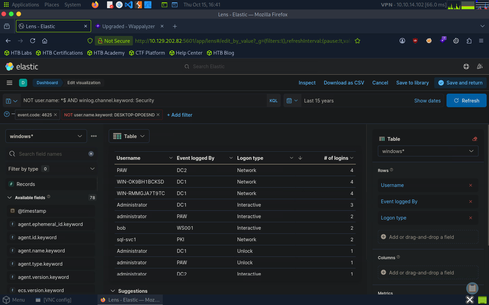

# Lab 02 — SIEM Visualization: Failed Logon Attempts

## Objective

Create and refine a Kibana dashboard to visualize failed Windows logon attempts, identify affected accounts and endpoints, and organize authentication data for security monitoring.

## Dashboard Configuration

- **Platform:** Kibana / Elastic Stack
- **Dashboard:** `SOC-Alerts`
- **Index pattern:** `windows*`
- **Visualization:** Data table
- **Metric:** Count of records
- **Time range:** Last 15 years

### Table Fields

| Field | Purpose |
|---|---|
| `user.name.keyword` | Username associated with the event |
| `host.hostname.keyword` | Endpoint reporting the event |
| `winlog.logon.type.keyword` | Logon type associated with the event |
| Count of records | Number of matching events |

The table columns were renamed to `Username`, `Event logged by`, `Logon Type`, and `# of logins`. Results were sorted by count to improve readability and help prioritize accounts with repeated failed logon attempts.

## Filtering and Refinement

**Exclude computer accounts and restrict results to Windows Security events:**

```kql
NOT user.name: *$ AND winlog.channel.keyword: Security
```

Additional filters were applied to exclude the following machine-related usernames:

- `DESKTOP-DPOESND`
- `WIN-OK9BH1BCKSD`
- `WIN-RMMGJA7T9TC`

These refinements reduce noise from computer accounts and unrelated events, making the visualization more useful for monitoring user authentication activity.

## Investigation Notes

- Used Kibana dashboards to organize authentication data into a reusable visualization.
- Configured table rows, record-count metrics, display names, and sorting.
- Included username, reporting endpoint, and logon type to provide investigation context.
- Applied filters to exclude computer accounts and unrelated Windows events.
- Saved the visualization and dashboard for subsequent investigation.

## Evidence



## Key Takeaways

- Built a Kibana dashboard for monitoring failed Windows logon attempts.
- Used aggregations to summarize authentication events by account and endpoint.
- Refined visualizations with filters, readable column names, and sorting.
- Applied KQL to exclude computer accounts and focus on Windows Security events.
- Improved the visibility of potentially suspicious authentication activity.