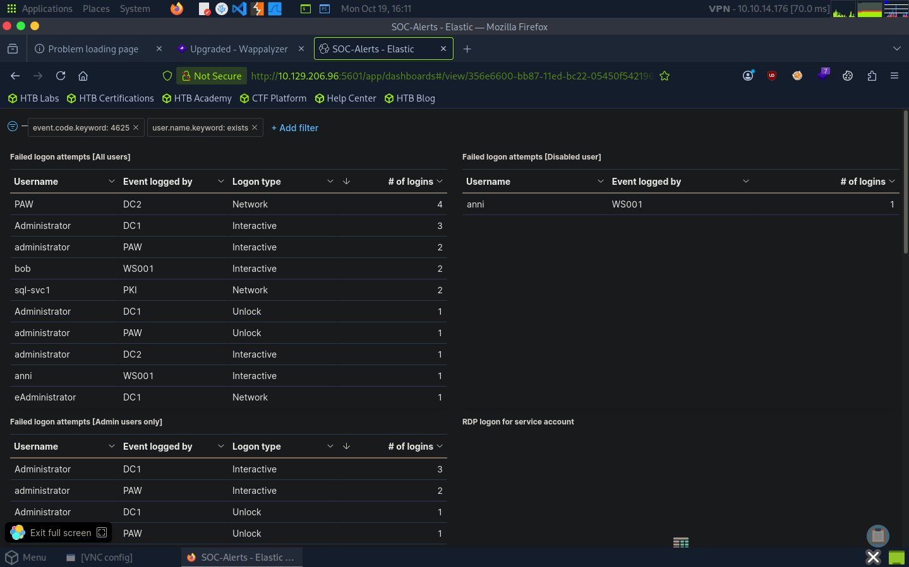

# Lab 03 — SIEM Visualization: Failed Logon Attempts (Disabled Users)

## Objective

Review a Kibana visualization designed to monitor failed Windows logon attempts involving disabled user accounts and understand how KQL filters scope the events displayed in the dashboard.

## Investigation Approach

- Opened the existing Kibana dashboard.
- Entered edit mode for the relevant visualization panel.
- Inspected the configured KQL query and filter details.
- Reviewed how the visualization was scoped to failed logon events involving disabled accounts.
- Examined the dashboard and panel configuration to understand how the event data was presented.

## KQL Filter Context

The following filter identifies failed Windows logon events associated with disabled accounts:

```kql
event.code:4625 AND winlog.event_data.SubStatus:0xC0000072
```

- `event.code:4625`: Filters for failed Windows logon events.
- `winlog.event_data.SubStatus:0xC0000072`: Identifies failures associated with disabled accounts.

## Visualization Notes

- **Platform:** Kibana / Elastic Stack
- **Index pattern:** `windows*`
- **Event category:** Windows authentication
- **Visualization:** Kibana dashboard table
- **Investigation method:** Reviewed the existing panel configuration and KQL filters in edit mode.

Inspecting the configured query helps explain which events are included in a visualization without relying solely on the dashboard's displayed results.

### Visualization Panel


## Key Takeaways

- Reviewed an existing Kibana visualization in edit mode.
- Inspected KQL filters used to scope Windows authentication events.
- Connected Windows event fields with the purpose of a SIEM visualization.
- Used dashboard and panel configuration details to support security event analysis.