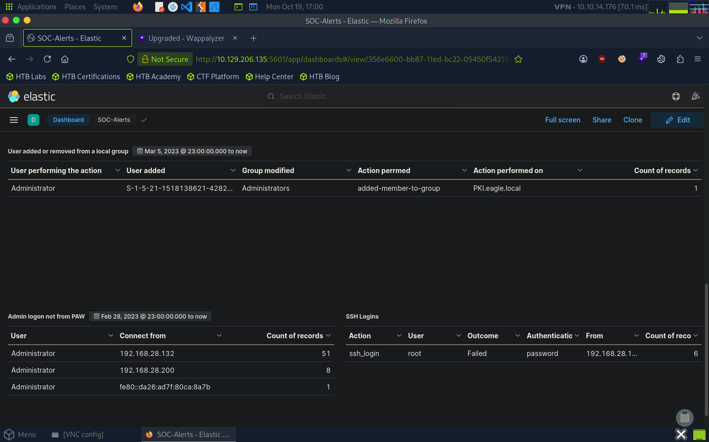

# Lab 04 — Skills Assessment: SOC Dashboard Review

## Objective

Review a SOC dashboard in Kibana and apply critical thinking to security events in the context of an organization's security policies, expected user behavior, and operational environment.

## Scenario Context

The assessment presented an organization with the following characteristics:

- Hosting infrastructure had migrated to the cloud, and the legacy DMZ was no longer in use.
- The IT Operations team consisted of four highly privileged administrators.
- Privileged administrative activities were required to take place on Privileged Access Workstations (PAWs).
- Endpoints followed CIS hardening baselines, with limited application whitelisting.
- Linux servers had little routine activity, and remote root access was blocked.
- Service accounts used a naming convention containing `-svc` and were intended for specific purposes.

These details established the baseline for evaluating whether observed events were consistent with expected operations.

## Dashboard Review

Reviewed the `SOC-Alerts` dashboard and its seven security visualizations:

- Failed logon attempts — all users
- Failed logon attempts — disabled users
- Failed logon attempts — administrator users
- RDP logons for service accounts
- Users added to or removed from local groups
- Administrator logons outside PAWs
- SSH logons

The review focused on identifying behavior that might violate the organization's stated policies or differ from its expected operating baseline.

## Investigation Approach

- Compared dashboard events with the scenario's operational context.
- Considered account privilege, authentication activity, endpoint identity, and expected administrative behavior.
- Reviewed whether service account activity aligned with the intended purpose of those accounts.
- Considered the appropriate triage approach for potentially suspicious events, including when operational context should be verified.

## Evidence

The screenshot captures the final three visualizations in the `SOC-Alerts` dashboard.

## Key Takeaways

- Used environmental context to assess security events rather than interpreting alerts in isolation.
- Evaluated authentication and administrative activity against established security policies.
- Recognized the importance of understanding service account purpose and expected system behavior.
- Applied critical thinking to SOC alert triage and escalation decisions.