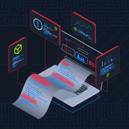

#  Windows Event Logs & Finding Evil

> HTB Academy — SOC Analyst Job Role Path (CDSA)

## Overview

This module explores Windows Event Logs, Sysmon, and Event Tracing for Windows (ETW) as sources of endpoint telemetry for security monitoring, threat detection, and incident investigation.

It covers event analysis, log correlation, suspicious activity identification, and PowerShell-based event querying.

---

## Windows Event Logs

Windows Event Logs centralize operating system, application, and security-related activities.

### Default Event Logs

| Log | Description |
|---|---|
| Application | Application-generated events |
| Security | Authentication, auditing, and security events |
| System | Operating system and service events |
| Setup | Installation and configuration events |
| Forwarded Events | Events collected from remote systems |

### Event Anatomy

| Field | Description |
|---|---|
| Log Name | Event log containing the record |
| Source | Component that generated the event |
| Event ID | Event identifier |
| Level | Severity of the event |
| Keywords | Event classification |
| User | Associated security principal |
| Logged | Event timestamp |
| Computer | Host that generated the event |
| XML Data | Structured event details |

---

## Important Windows Event IDs

| Event ID | Description |
|---|---|
| 4624 | Successful logon |
| 4625 | Failed logon |
| 4648 | Logon using explicit credentials |
| 4672 | Special privileges assigned to a new logon |
| 4688 | Process creation |
| 4719 | System audit policy changed |
| 4907 | Auditing settings on an object changed |
| 1102 | Security audit log cleared |

### Event Correlation

Correlating events through identifiers such as Logon ID helps reconstruct activity associated with a particular logon session.

**Event ID 4624 — Successful Logon**

Useful fields:

- TargetUserName
- TargetDomainName
- TargetLogonId
- LogonType
- ProcessName

**Event ID 4907 — Auditing Settings Changed**

Useful fields:

- SubjectLogonId
- ObjectName
- ProcessName
- Original Security Descriptor
- New Security Descriptor

The Logon ID can be used to correlate authentication activity with subsequent object auditing events.

### SACL and Object Auditing

A System Access Control List (SACL) defines which access attempts against an object should be audited.

Event ID 4907 records changes to an object's auditing settings.

Security Descriptor comparisons can help identify modifications to auditing configurations.

---


## Sysmon & Endpoint Telemetry

Sysmon extends Windows endpoint visibility by recording detailed system activity in its Operational event log.

| Event ID | Event | Investigation Use |
|---|---|---|
| 1 | Process Create | Process execution and parent-child relationships |
| 3 | Network Connect | Network connections and potential C2 activity |
| 7 | Image Loaded | DLL loading and suspicious module execution |
| 8 | CreateRemoteThread | Remote thread creation and process injection |
| 10 | Process Access | Access to sensitive processes, including LSASS |

### Event Correlation

Useful Sysmon Event ID 1 fields:

- Image and CommandLine
- ParentImage and ParentCommandLine
- ProcessGuid and ParentProcessGuid
- ProcessId and ParentProcessId
- User and Hashes

For Event ID 7, investigate Image, ImageLoaded, Signed and SignatureStatus.

For Event ID 8, correlate SourceImage and TargetImage to identify the process initiating remote thread creation.

For Event ID 10, inspect SourceImage, TargetImage, GrantedAccess and CallTrace. An access event alone does not prove that a credential dump occurred.

### Detection Considerations

- Unexpected DLLs loaded from writable directories may indicate DLL hijacking.
- Loading clr.dll and clrjit.dll in unusual processes may indicate unexpected .NET execution.
- Event ID 8 can reveal certain process injection techniques.
- Access to lsass.exe should be investigated in context, including access rights and related telemetry.
- Unexpected parent-child relationships can indicate parent PID spoofing or unusual execution chains.

---

## Event Tracing for Windows (ETW)

Event Tracing for Windows (ETW) is a high-performance Windows tracing facility that collects telemetry from user-mode applications and kernel-mode components.

Unlike traditional event log analysis alone, ETW allows investigators to enable specific providers and collect detailed runtime information.

### ETW Architecture

| Component | Responsibility |
|---|---|
| Controllers | Manage tracing sessions and enable providers |
| Providers | Generate events |
| Consumers | Receive and process events |
| Channels | Organize events for event log consumption |
| ETL files | Store event trace data for later analysis |

### Logman

Logman is a built-in Windows utility for inspecting and managing ETW sessions and providers.

```cmd
logman.exe query -ets
logman.exe query "EventLog-System" -ets
logman.exe query providers
logman.exe query providers | findstr "Process"
```

The `-ets` parameter queries active Event Tracing Sessions.

Provider metadata includes GUIDs, available keywords, event levels and associated processes.

### Relevant ETW Providers

| Provider | Security Visibility |
|---|---|
| Microsoft-Windows-Kernel-Process | Process creation and termination |
| Microsoft-Windows-Kernel-File | File system operations |
| Microsoft-Windows-Kernel-Network | Kernel-level network activity |
| Microsoft-Windows-DotNETRuntime | .NET runtime and assembly activity |
| Microsoft-Windows-Kernel-Registry | Registry operations |
| Microsoft-Windows-PowerShell | PowerShell activity |
| Microsoft-Windows-DNS-Client | DNS client activity |

Some high-value providers are restricted. Microsoft-Windows-Threat-Intelligence, for example, requires privileged access associated with Protected Process Light (PPL).

### SilkETW

SilkETW is a collection tool that captures ETW telemetry and can write events to JSON files.

Example: collect process telemetry:

```cmd
SilkETW.exe -t user -pn Microsoft-Windows-Kernel-Process -ot file -p C:\Windows\Temp\kernel-process.json
```

Example: collect .NET runtime telemetry:

```cmd
SilkETW.exe -t user -pn Microsoft-Windows-DotNETRuntime -uk 0x2038 -ot file -p C:\Windows\Temp\dotnet-runtime.json
```

The keyword mask `0x2038` selects:

| Keyword | Purpose |
|---|---|
| JIT | Just-In-Time compilation |
| Interop | Managed and unmanaged code interaction |
| Loader | Assembly loading |
| NGen | Native Image Generator activity |

### Sysmon and ETW Complement Each Other

Sysmon Event ID 1 may report a spoofed parent process in a Parent PID Spoofing scenario. ETW telemetry from Microsoft-Windows-Kernel-Process can provide additional visibility into the actual process creation activity.

Sysmon Event ID 7 records DLL loading, including .NET runtime libraries such as clr.dll and mscoree.dll. The Microsoft-Windows-DotNETRuntime provider provides deeper runtime visibility, including assembly loading and method-related events.

ETW provider selection should be targeted to the investigation objective because some providers can generate substantial event volumes.

---

## XML Event Filtering

Event Viewer supports custom XML queries for more precise filtering.

### Filter by Event ID and Logon ID

```xml
<QueryList>
  <Query Id="0" Path="Security">
    <Select Path="Security">
      *[System[(EventID=4907)] and EventData[
        Data[@Name='SubjectLogonId']='0x123456'
      ]]
    </Select>
  </Query>
</QueryList>
```

Replace the example Logon ID with the identifier observed in the investigation.

### Filter by Object Name

```xml
<QueryList>
  <Query Id="0" Path="Security">
    <Select Path="Security">
      *[System[(EventID=4907)] and EventData[
        Data[@Name='ObjectName']='C:\Path\To\File'
      ]]
    </Select>
  </Query>
</QueryList>
```

Replace the example path with the object being investigated.

---

## PowerShell — Get-WinEvent

`Get-WinEvent` retrieves event records from Windows event logs and supports filtering by log name, event ID, and time range.

### Retrieve Security Events

```powershell
Get-WinEvent -FilterHashtable @{
    LogName = 'Security'
    Id = 4624, 4907
} -MaxEvents 50 |
Select-Object TimeCreated, Id, ProviderName, Message
```

### Search Events by Logon ID

```powershell
$LogonId = '0x123456'

Get-WinEvent -FilterHashtable @{
    LogName = 'Security'
    Id = 4907
} |
Where-Object {
    $_.Message -match [regex]::Escape($LogonId)
} |
Select-Object TimeCreated, Id, Message
```

### Retrieve Events from a Specific Time Range

```powershell
$Start = Get-Date '2026-01-01 10:00:00'
$End   = Get-Date '2026-01-01 11:00:00'

Get-WinEvent -FilterHashtable @{
    LogName = 'Security'
    Id = 4624, 4907
    StartTime = $Start
    EndTime = $End
} |
Select-Object TimeCreated, Id, Message
```

---


### Query Exported EVTX Files

Get-WinEvent can also query exported event files recursively.

```powershell
Get-ChildItem -Path 'C:\Logs' -Filter *.evtx -Recurse -File |
ForEach-Object {
    Get-WinEvent -Path $_.FullName -MaxEvents 200 -ErrorAction SilentlyContinue
} |
Where-Object { $_.Id -in 1, 7, 8, 10 } |
Select-Object TimeCreated, Id, ProviderName, Message
```

Use targeted filters whenever possible to reduce noise and improve investigation efficiency.

## Investigation Workflow

```text
Identify Relevant Event
          ↓
Inspect Event Details
          ↓
Extract Logon ID
          ↓
Correlate Related Events
          ↓
Inspect Object and Process
          ↓
Validate Timestamp and Evidence
          ↓
Document Findings
```

---

## Lab Environment

### Remote Desktop — FreeRDP

Connect to Windows lab targets from Athena OS using FreeRDP 3.

```bash
xfreerdp3 /v:<TARGET_IP> /u:Administrator /d:. '/auth-pkg-list:none,ntlm' /dynamic-resolution /cert:ignore
```

Credentials should be entered interactively rather than stored in scripts or documentation.

### VPN Connectivity

Check the route to the target:

```bash
ip route get <TARGET_IP>
```

The route should use the active HTB VPN interface.

---

## Lab Evidence

Personal lab evidence is retained locally and excluded from this public repository.

Practical exercises and evidence are organized in the [Labs directory](./labs/).

---

## Key Takeaways

- Windows Event Logs provide valuable endpoint security telemetry.
- Event IDs help identify authentication and auditing activities.
- Logon IDs enable correlation between related security events.
- Event ID 4907 records modifications to object auditing settings.
- SACLs define which object access attempts are audited.
- XML queries provide precise event filtering.
- PowerShell Get-WinEvent supports efficient event investigation.
- Event correlation helps reconstruct activity and establish timelines.

---

- Sysmon Event IDs 1, 3, 7, 8 and 10 provide useful endpoint telemetry.
- ETW extends visibility through configurable event providers and tracing sessions.
- SilkETW enables collection of ETW telemetry for offline investigation.
- Get-WinEvent supports filtering and querying local logs and exported EVTX files.

## Completion

<a href="https://academy.hackthebox.com/achievement/badge/435d5dca-d967-11f1-8591-0affe7dfeb45">
  
</a>

**Completed:** 5 November 2026

**Status:** In progress

---

## References

- [Hack The Box Academy — Windows Event Logs & Finding Evil](https://academy.hackthebox.com/course/preview/windows-event-logs--finding-evil)
- [Microsoft — Windows Security Auditing](https://learn.microsoft.com/en-us/windows/security/threat-protection/auditing/)
- [Microsoft — Get-WinEvent](https://learn.microsoft.com/en-us/powershell/module/microsoft.powershell.diagnostics/get-winevent)
- [Microsoft — Access Control Lists](https://learn.microsoft.com/en-us/windows/win32/secauthz/access-control-lists)
