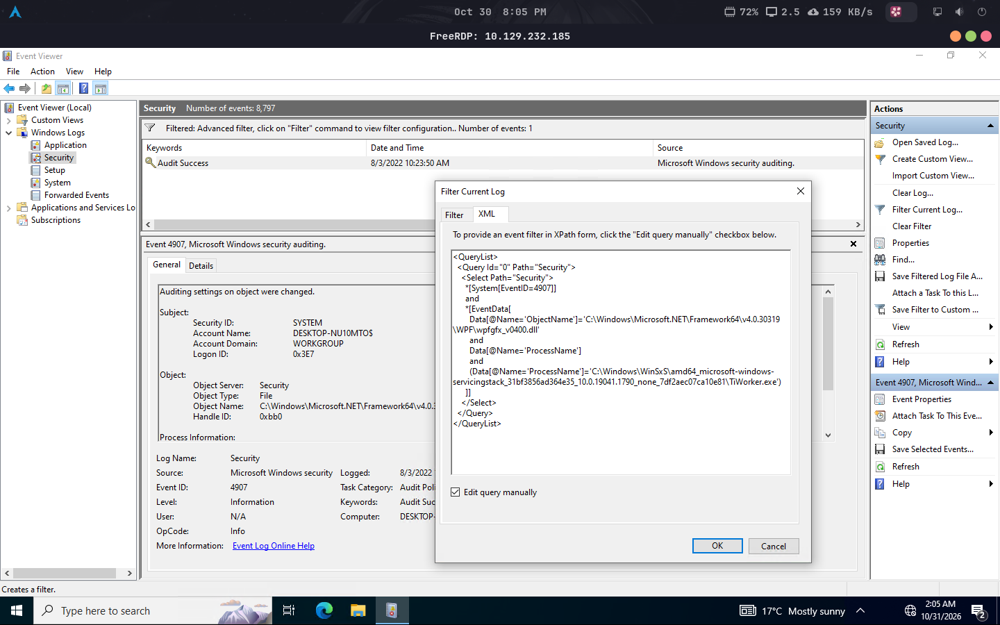

# Lab 01 — Windows Event Logs

> HTB Academy — Windows Event Logs & Finding Evil

## Overview

Hands-on practice with Windows Security logs, event investigation, and custom XML filtering.

## Environment

| Component | Tool |
|---|---|
| Operating System | Athena OS |
| Virtualization | Oracle VirtualBox |
| Remote Desktop | FreeRDP 3 |
| Target | Windows 10 |
| Log Analysis | Windows Event Viewer |

## Event Investigation

### Event ID 4624 — Successful Logon

- Identify the account associated with the logon.
- Inspect the Logon Type.
- Extract the Logon ID.
- Review process and authentication information.

### Event ID 4907 — Auditing Settings Changed

- Inspect the SubjectLogonId.
- Identify the affected ObjectName.
- Review ProcessName.
- Compare original and new security descriptors.

### Event Correlation

Correlate events using Logon IDs to connect authentication activity with subsequent object auditing changes.

## XML Filtering

Custom XML queries can narrow Security events by Event ID, Logon ID, and object attributes.

Example:

```xml
<QueryList>
  <Query Id="0" Path="Security">
    <Select Path="Security">
      *[System[(EventID=4907)] and EventData[
        Data[@Name='SubjectLogonId']='0x123456'
      ]]
    </Select>
  </Query>
</QueryList>
```

Replace `0xLOGON_ID` with the Logon ID observed during the investigation.

## Evidence

Event Viewer XML filtering performed during the practical exercise.



## Key Takeaways

- Event ID 4624 records successful logons.
- Event ID 4907 records changes to object auditing settings.
- Logon IDs support event correlation.
- ProcessName identifies the process associated with an auditing change.
- ObjectName identifies the affected object.
- XML filtering helps focus investigations.

---

[Back to Labs](../README.md) · [Back to Module](../../README.md)
