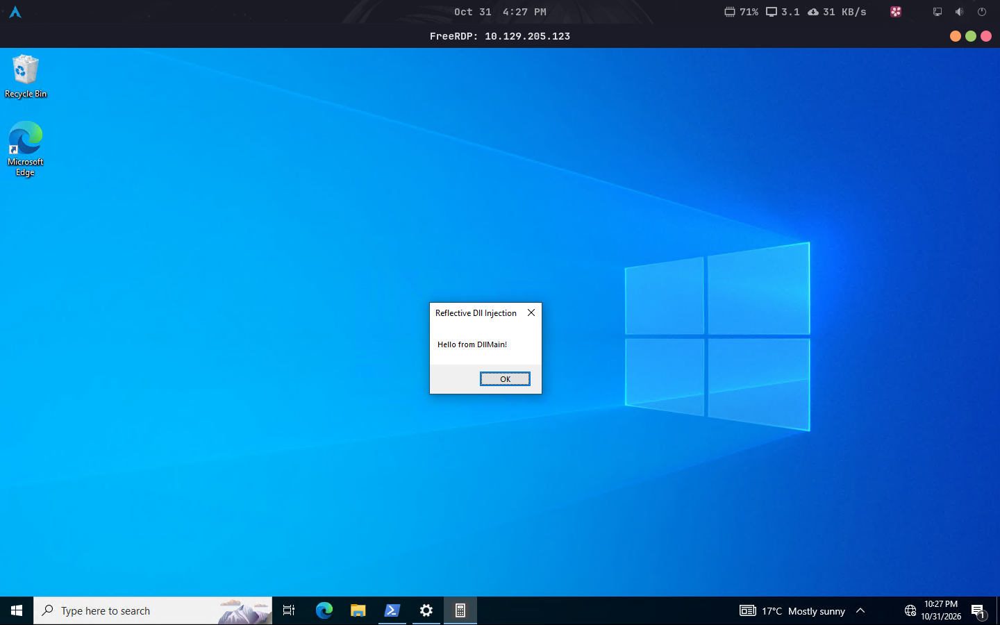

# Lab 02 — Sysmon Event Analysis

> HTB Academy — Windows Event Logs & Finding Evil

## Overview

Hands-on practice with Sysmon for endpoint telemetry collection and security monitoring.

The exercise focused on analyzing process activity, DLL loading, .NET runtime behavior, and suspicious process access to identify potentially malicious activity.

## Environment

| Component | Tool |
|---|---|
| Attacker Environment | Athena OS |
| Virtualization | Oracle VirtualBox |
| Remote Access | FreeRDP 3 |
| Target | Windows 10 |
| Telemetry | Sysmon |
| Analysis | Event Viewer, PowerShell |

## Sysmon Event Analysis

Relevant Sysmon event identifiers reviewed during the exercise:

| Event ID | Event Type | Investigation Focus |
|---|---|---|
| 1 | Process Creation | Process execution and command-line activity |
| 3 | Network Connection | Process network activity |
| 7 | Image Loaded | DLL loading, file paths, signatures, and hashes |
| 10 | Process Access | Interactions between processes and access to sensitive processes |

## Investigation Workflow

### Image Load Monitoring — Event ID 7

Reviewed image-loading telemetry to identify unusual DLL loading behavior.

Investigation points:

- Process image and executable location.
- Loaded module path.
- Digital signature and signature status.
- File hashes.
- Expected versus unusual DLL locations.

### .NET Runtime Monitoring

Reviewed CLR-related module loading as an indicator of managed code execution within processes.

Relevant modules:

- `clr.dll`
- `clrjit.dll`

The presence of runtime components in an unexpected process can justify further investigation.

### Process Access Monitoring — Event ID 10

Reviewed process access telemetry to understand interactions with sensitive Windows processes.

Investigation points:

- Source and target process.
- Source and target user.
- Access type and granted access.
- Process location and execution context.

Legitimate security software may also access sensitive processes, so findings must be validated against expected behavior.

## PowerShell Event Investigation

Retrieve Sysmon image-load events:

```powershell
Get-WinEvent -FilterHashtable @{
    LogName = 'Microsoft-Windows-Sysmon/Operational'
    Id = 7
} -MaxEvents 100 |
Select-Object TimeCreated, Id, Message
```

Retrieve process-access events:

```powershell
Get-WinEvent -FilterHashtable @{
    LogName = 'Microsoft-Windows-Sysmon/Operational'
    Id = 10
} -MaxEvents 100 |
Select-Object TimeCreated, Id, Message
```

## Evidence

### Controlled DLL Loading Demonstration

The screenshot records the visible result of a controlled DLL-loading experiment performed in the Windows environment.



## Key Takeaways

- Sysmon provides detailed endpoint telemetry beyond standard Windows event logging.
- Event ID 7 helps investigate suspicious DLL loading.
- CLR and CLR JIT modules provide useful runtime execution context.
- Event ID 10 supports investigations involving sensitive process access.
- File paths, signatures, hashes, and process relationships should be correlated before classifying activity as malicious.
- Sysmon configuration directly affects event visibility and collection volume.

## References

- [Microsoft Sysmon Documentation](https://learn.microsoft.com/en-us/sysinternals/downloads/sysmon)
- [SwiftOnSecurity Sysmon Configuration](https://github.com/SwiftOnSecurity/sysmon-config)

---

[Back to Labs](../README.md) · [Back to Module](../../README.md)
