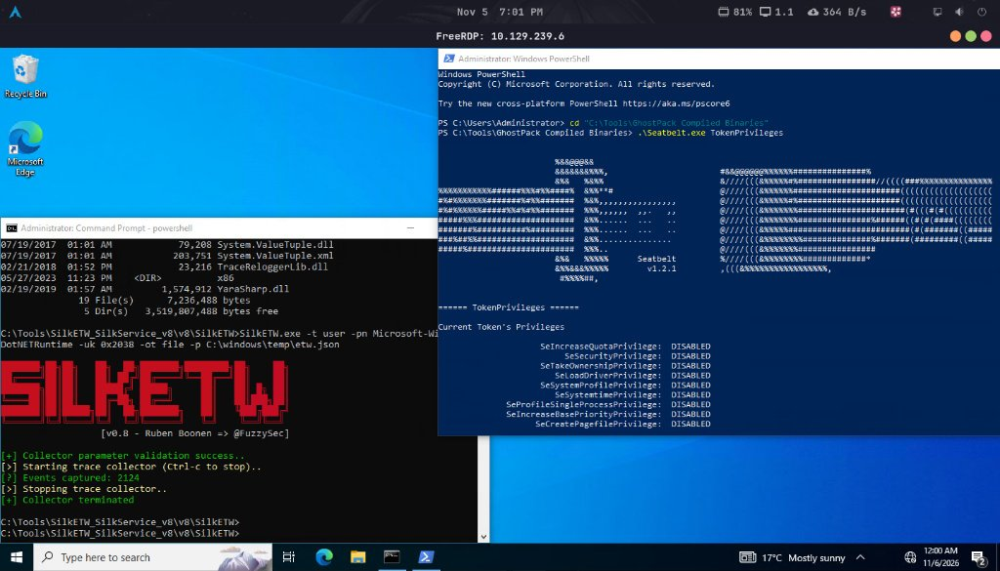

# Lab 03 — Tapping Into ETW

> HTB Academy — Windows Event Logs & Finding Evil

## Overview

This exercise demonstrates how Event Tracing for Windows (ETW) can provide additional endpoint telemetry when traditional Windows Event Logs and Sysmon do not provide sufficient context.

The practical scenarios focus on process creation anomalies and .NET assembly execution.

## Environment

| Component | Tool / Configuration |
|---|---|
| Attacker environment | Athena OS |
| Virtualization | Oracle VirtualBox |
| Remote access | FreeRDP |
| Windows telemetry | Sysmon and ETW |
| ETW collection | SilkETW |
| Runtime analysis | Microsoft-Windows-DotNETRuntime |

## Concepts & Techniques

### Parent PID Spoofing

A process can be created with a misleading parent process identifier.

Sysmon Event ID 1 may report the spoofed parent relationship. ETW telemetry from Microsoft-Windows-Kernel-Process provides additional visibility into process creation and can help identify the actual creator.

### Bring Your Own Land (BYOL)

BYOL describes the use of custom-built .NET assemblies instead of relying exclusively on tools already installed on the target.

Assemblies may execute directly in memory, reducing the artifacts left on disk.

### .NET Runtime Monitoring

The .NET runtime loads components such as clr.dll and mscoree.dll.

Sysmon Event ID 7 can record these image-loading events. The Microsoft-Windows-DotNETRuntime provider offers deeper insight into runtime activity and assembly loading.

## Commands & Queries

### Inspect ETW Sessions

```cmd
logman.exe query -ets
```

### Enumerate Providers

```cmd
logman.exe query providers
logman.exe query providers | findstr "Process"
```

### Collect Kernel Process Events

```cmd
SilkETW.exe -t user -pn Microsoft-Windows-Kernel-Process -ot file -p C:\Windows\Temp\kernel-process.json
```

### Collect .NET Runtime Events

```cmd
SilkETW.exe -t user -pn Microsoft-Windows-DotNETRuntime -uk 0x2038 -ot file -p C:\Windows\Temp\dotnet-runtime.json
```

The `0x2038` keyword mask selects JIT, Interop, Loader and NGen telemetry.

## Observations

- ETW can complement Sysmon when investigating suspicious process relationships.
- Kernel process telemetry provides additional context about process creation.
- Sysmon Event ID 7 identifies loaded DLLs but does not describe all runtime behavior.
- DotNETRuntime telemetry can provide assembly and method-related details.
- ETW collection should use targeted providers and keywords to control event volume.

## Evidence



## Key Takeaways

- ETW is a complementary source of endpoint telemetry.
- Logman helps inspect ETW sessions and provider metadata.
- SilkETW collects ETW events for subsequent analysis.
- Sysmon and ETW provide different but complementary investigative perspectives.
- .NET runtime telemetry helps investigate suspicious assembly execution.

---

[Back to Labs](../README.md) · [Back to Module](../../README.md)
