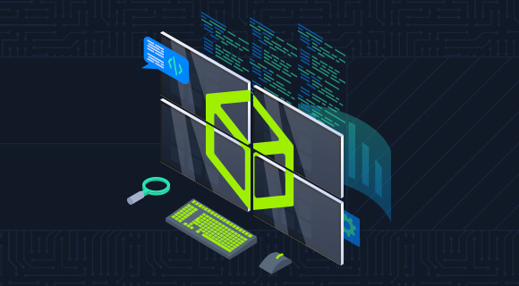

#  Security Monitoring & SIEM Fundamentals

> HTB Academy — SOC Analyst Job Role Path (CDSA)

## Overview

A Security Information and Event Management (SIEM) solution centralizes security logs and events from multiple sources to support threat detection, investigation, and incident response.

## SIEM Fundamentals

### SIM vs. SEM

| Technology | Primary Function |
|---|---|
| SIM — Security Information Management | Log collection, storage, analysis, and reporting |
| SEM — Security Event Management | Event monitoring, correlation, and alerting |
| SIEM | Combines SIM and SEM capabilities |

### Core Functions

- **Log ingestion:** Collect events from endpoints, servers, applications, and network devices.
- **Normalization and aggregation:** Standardize and consolidate collected data.
- **Correlation and detection:** Identify suspicious patterns across multiple sources.
- **Alerting and investigation:** Notify analysts and provide context for triage.
- **Reporting and compliance:** Support auditing, monitoring, and security reporting.

## SIEM Data Flow

```text
Log Sources
    ↓
Ingestion
    ↓
Normalization & Aggregation
    ↓
Correlation & Detection
    ↓
Alerts & Investigation
    ↓
Incident Response
```

## Alert Tuning & Context

High alert volumes and false positives can cause **alert fatigue**.

Detection rules should be tuned and alerts enriched with context so analysts can prioritize relevant threats, identify affected systems, and investigate suspicious activity efficiently.

## SIEM vs. IDS/IPS

A SIEM complements rather than replaces tools such as IDS/IPS, firewalls, and endpoint security solutions.

It combines their telemetry with other log sources to help analysts identify events that may be suspicious when correlated across the environment.

## Key Takeaways

- SIEM centralizes logs and security events from multiple sources.
- Normalization and correlation support effective detection.
- Context helps analysts distinguish genuine threats from false positives.
- Detection rules require tuning to reduce alert fatigue.
- SIEM supports investigation, incident response, monitoring, and compliance.

## Completion

<a href="https://academy.hackthebox.com/achievement/2133209/211">
  
</a>

**Completed:** 19 October 2026
## References

- [HTB Academy — Security Monitoring & SIEM Fundamentals](https://academy.hackthebox.com/course/preview/security-monitoring--siem-fundamentals)
- [MITRE ATT&CK](https://attack.mitre.org/)