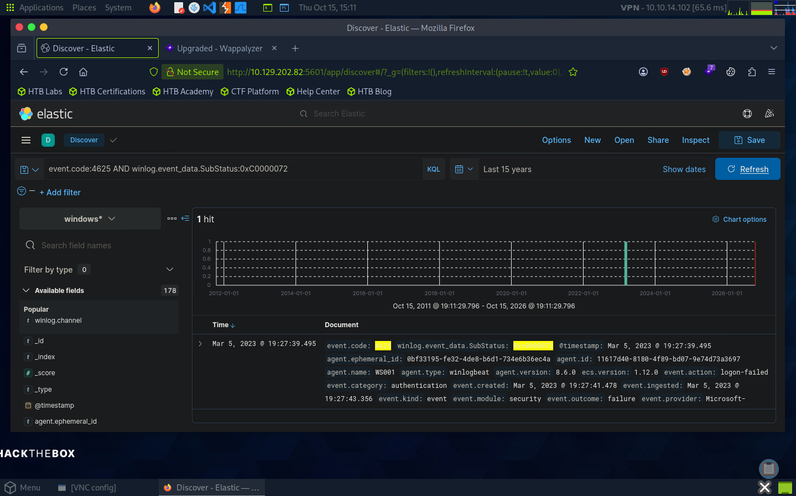

# Lab 01 — Introduction to the Elastic Stack

## Objective

Use Kibana Discover and Kibana Query Language (KQL) to investigate Windows authentication events and identify failed logons involving disabled accounts.

## Queries Used

**Search for failed Windows logons:**

```kql
event.code:4625
```

**Filter failed logons involving disabled accounts:**

```kql
event.code:4625 AND winlog.event_data.SubStatus:0xC0000072
```

**Filter events within a specific time range:**

```kql
event.code:4625 AND winlog.event_data.SubStatus:0xC0000072 AND @timestamp >= "2023-03-03T00:00:00.000Z" AND @timestamp <= "2023-03-06T23:59:59.999Z"
```

## Investigation Notes

- **Kibana Discover:** Used to search and inspect indexed Windows event logs.
- **Index pattern:** `windows*`
- **Event ID 4625:** Failed logon attempt.
- **SubStatus `0xC0000072`:** Indicates a disabled account.
- **`winlog.event_data.TargetUserName`:** Identifies the account targeted by the logon attempt.
- **`agent.name`:** Identifies the reporting endpoint, not the username.

The investigation required examining the event fields to distinguish the affected account from the host that generated the event.

## Evidence



## Key Takeaways

- Used KQL to filter Windows authentication events.
- Combined conditions and timestamps to narrow search results.
- Inspected event fields to identify the relevant account.
- Distinguished endpoint metadata from authentication data.