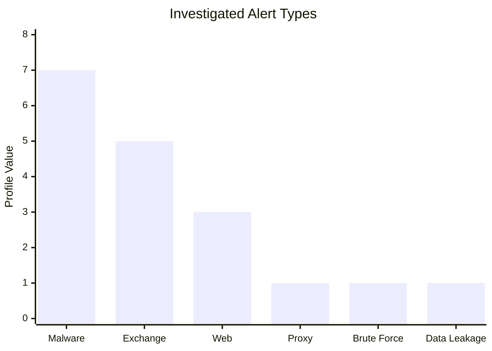

# LETSDEFEND | SOC ANALYST DASHBOARD

**Joaopmsitz** · SOC Training & Investigation Performance

[Public Profile](https://app.letsdefend.io/user/JoaopmsItz) · [Investigation Reports](./investigations/README.md)

*Profile metrics snapshot — November 18, 2026*

---

## 01 | Performance Overview

<table>
<tr>
<td align="center" width="33%">

<h2>1,913</h2>

**TOTAL SCORE**

Platform points

</td>
<td align="center" width="33%">

<h2>94%</h2>

**SUCCESS RATE**

Platform-reported rate

</td>
<td align="center" width="33%">

<h2>19,266</h2>

**SLA (UNIT UNSPECIFIED)**

Platform-reported value; unit not specified in the public profile

</td>
</tr>
</table>

---

## 02 | Alert Investigation Distribution

The public profile exposes 16 alert-category labels. The values below are platform-reported activity figures and are separate from this repository's documented case count.

### Category Breakdown (Platform-Reported Activity)

| Alert Category | Activity Value |
|---|---:|
| Malware | 7 |
| Exchange | 5 |
| Web Attack | 3 |
| Proxy | 1 |
| Brute Force | 1 |
| Data Leakage | 1 |
| Mobile | 0 |
| ThreatIntel | 0 |
| Ransomware | 0 |
| Generic | 0 |
| Unauthorized Access | 0 |
| LOLBin | 0 |
| Persistence | 0 |
| C2 | 0 |
| Privilege Escalation | 0 |
| APT Group | 0 |

Source: Public LetsDefend profile. Values represent the category breakdown supplied by the platform and are separate from the number of reports published in this repository.

---

## 03 | Technical Knowledge Areas

Areas listed in the LetsDefend profile:

| Knowledge Area | Focus |
|---|---|
| Dynamic Malware Analysis | Malware behavior and execution analysis |
| MITRE ATT&CK Framework | Adversary tactics and techniques |
| IT Security Fundamentals | Information security foundations |
| Malicious Document Analysis | Suspicious documents and embedded content |

---

## 04 | Achievements & Badges

| Achievement | Date |
|---|---|
| Introduction to Security+ | October 15, 2026 |
| SOC Analyst Learning Path | September 28, 2026 |
| Lab Builder | September 28, 2026 |

---

Note: "Introduction to Security+" is a LetsDefend platform achievement, not the CompTIA Security+ certification.

---

## 05 | Investigation Portfolio

Technical investigation reports are maintained separately to avoid duplicating case information in this dashboard.

**[Explore the LetsDefend Investigation Catalog →](./investigations/README.md)**

The catalog provides category navigation, individual case reports, investigation methodology, and technical findings.

---

**LETSDEFEND PROFILE**

[Joaopmsitz](https://app.letsdefend.io/user/JoaopmsItz)

[Back to Cybersecurity Portfolio](../README.md)

