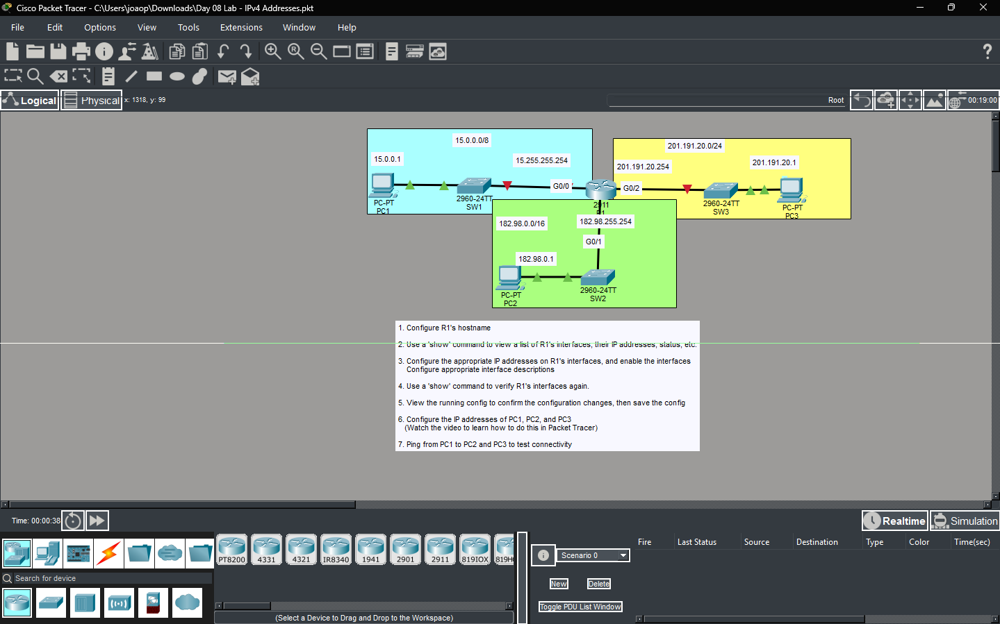
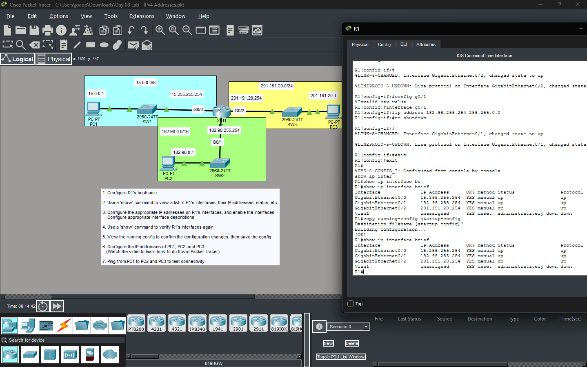
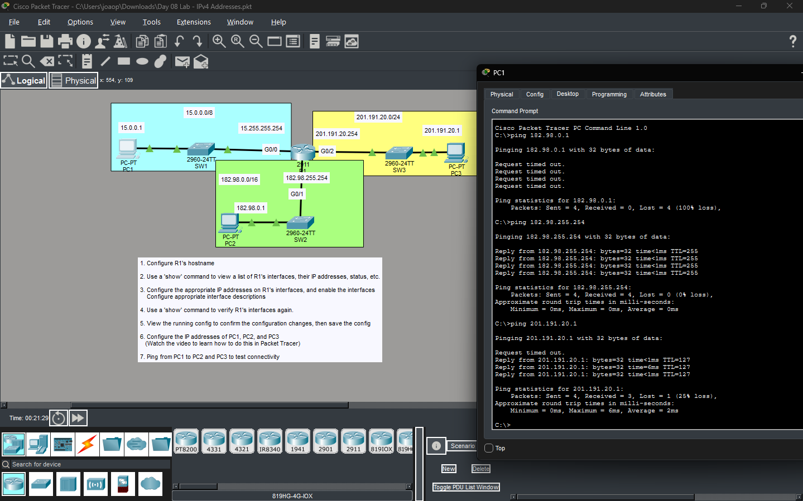

# Day 4 — Basic Device Security

Lab completed as part of **Jeremy's IT Lab — Free CCNA 200-301 Complete Course**.

## Topics

* Cisco IOS CLI
* Privileged EXEC mode
* Global configuration mode
* Device passwords
* `enable password`
* `enable secret`
* `service password-encryption`
* Saving the configuration

## Lab

Configured basic password security on a Cisco device using Cisco Packet Tracer.

The lab included configuring an enable password and secret, enabling password encryption, checking the running configuration, and saving the configuration.

## Verification

Used the following commands to verify the configuration:

```cisco
show running-config
copy running-config startup-config
```

## Evidence

### Screenshot 1



### Screenshot 2



### Screenshot 3



## Tool

* Cisco Packet Tracer

## Reference

Jeremy's IT Lab — Free CCNA 200-301 Complete Course
Day 4 — Basic Device Security

