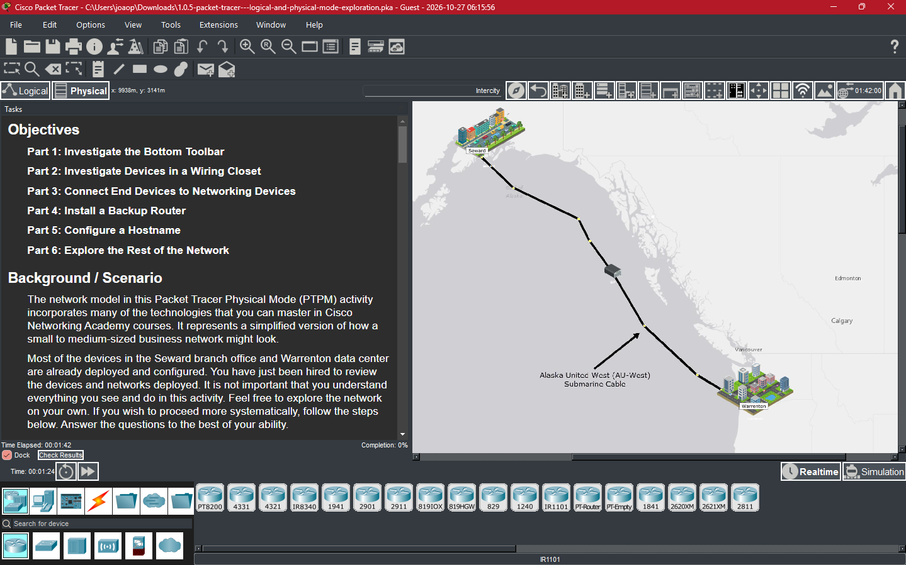
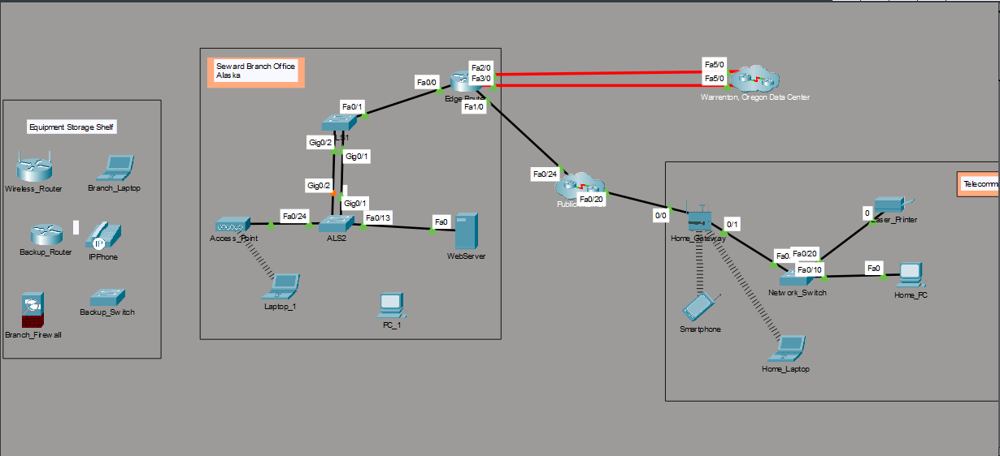
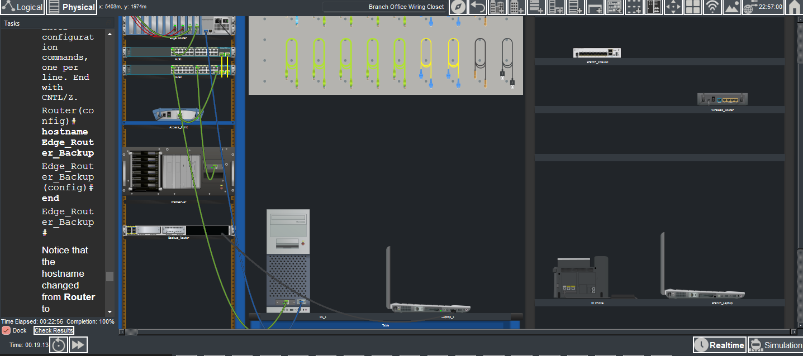

# Packet Tracer — Logical and Physical Mode Exploration

> Cisco Networking Academy — CCNA 2: Switching, Routing, and Wireless Essentials (SRWE)

## Overview

This Packet Tracer activity explores network devices, cabling, physical device installation, router configuration, and the differences between Logical and Physical workspaces.

## Objectives

- Investigate the Packet Tracer bottom toolbar.
- Inspect devices in a wiring closet.
- Connect end devices to networking devices.
- Install a backup router.
- Configure a router hostname.
- Explore the rest of the network in Logical and Physical modes.

## Part 1 — Investigate the Bottom Toolbar

Inspected the device categories and subcategories available in Packet Tracer.

## Part 2 — Investigate Devices in a Wiring Closet

**Question D — What devices use a wired connection to connect to switch ALS2?**

Access_Point and Web_Server.

**Question E — Which device is connected to Access_Point?**

Laptop_1.

**Question F — Where is the device connected to Access_Point physically located?**

On the table.

## Part 3 — Connect End Devices to Networking Devices

- Connected PC_1 to switch ALS2 using a copper straight-through cable.
- Connected PC_1 to Edge_Router using a console connection.
- Inspected the available device ports and cable connections.

## Part 4 — Install a Backup Router

- Installed Backup_Router in the rack.
- Powered on the router.
- Connected Laptop_1 to the router using a USB console cable.

## Part 5 — Configure a Hostname

Used the terminal on Laptop_1 to configure the backup router hostname.

```text
enable
configure terminal
hostname Edge_Router_Backup
end
```

The configured hostname is `Edge_Router_Backup`.

## Part 6 — Explore the Rest of the Network

Inspected the network topology in Logical mode and explored the physical layout of the devices.

## Logical Mode — Network Topology



## Completion Evidence — 100%

The final screenshot records the completed activity and network in Physical mode.



## Status

**Completed — 100%**

## Tools

- Cisco Packet Tracer
- Cisco Networking Academy

---

[Back to CCNA 2](../README.md) · [Back to NetAcad Courses](../../README.md) · [Back to Networking](../../../README.md)
